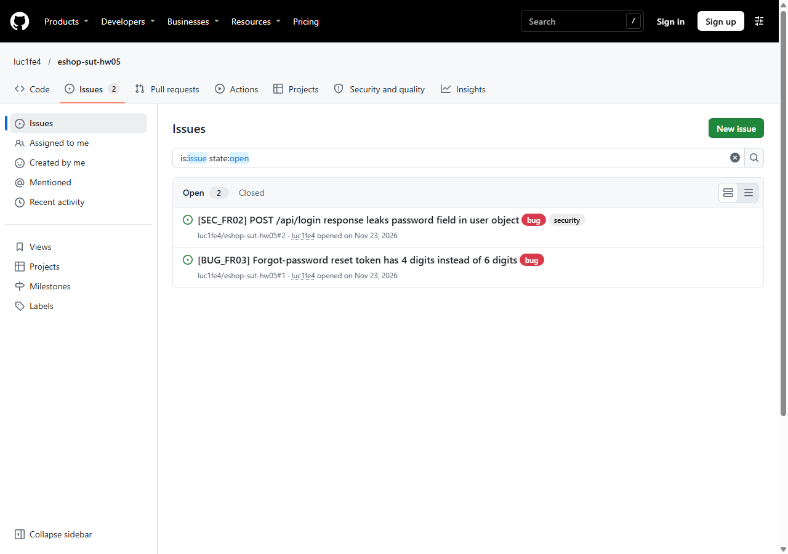

# GitHub Issues Report - Đã đăng thực tế

Đã xác minh và đăng thành công **2 phát hiện chức năng/bảo mật trong phạm vi M5** lên repository [https://github.com/luc1fe4/eshop-sut-hw05/issues](https://github.com/luc1fe4/eshop-sut-hw05/issues).

## Danh sách GitHub Issues đã đăng

1. [Issue #1: [BUG_FR03] Forgot-password reset token has 4 digits instead of 6 digits](https://github.com/luc1fe4/eshop-sut-hw05/issues/1)
2. [Issue #2: [SEC_FR02] POST /api/login response leaks password field in user object](https://github.com/luc1fe4/eshop-sut-hw05/issues/2)

---

## Chi tiết Issue 1: [BUG_FR03] Forgot-password reset token has 4 digits instead of 6 digits
- **URL:** [https://github.com/luc1fe4/eshop-sut-hw05/issues/1](https://github.com/luc1fe4/eshop-sut-hw05/issues/1)
- **Labels:** `bug`
- **Environment:** Windows PHUC, Node 22.17.1; SUT backend clone.
- **Reproduction:** Chạy `node scripts/contract-probe.cjs results/contract-probe.json`. Gọi Register -> Forgot -> Reset -> Login -> GET Cart. Xem metadata `reset_token.length`.
- **Expected:** README FR-03 quy định OTP 6 chữ số ngẫu nhiên; `api_specification.md:42` minh họa `resetToken` 6 chữ số.
- **Actual:** Runtime trả chuỗi token dài 4 chữ số; `backend/server.js:72` sử dụng `Math.floor(1000 + Math.random()*9000)`.
- **Severity & Impact:** Medium. Token 4 chữ số dễ bị tấn công brute-force hơn nếu không có rate limiting.
- **Evidence:** `results/contract-probe.json`, `backend/server.js:72`, `screenshots/github-issues.png`.

---

## Chi tiết Issue 2: [SEC_FR02] POST /api/login response leaks password field in user object
- **URL:** [https://github.com/luc1fe4/eshop-sut-hw05/issues/2](https://github.com/luc1fe4/eshop-sut-hw05/issues/2)
- **Labels:** `bug`, `security`
- **Environment:** Windows PHUC, Node 22.17.1; SUT backend clone.
- **Reproduction:** Login với tài khoản hợp lệ. Kiểm tra object `user` trong JSON response.
- **Expected:** Phù hợp với yêu cầu SEC-01 và nguyên tắc bảo mật: thông tin nhạy cảm như `password` không bao giờ được trả về trong API response.
- **Actual:** `backend/server.js:35, 52` thực hiện `SELECT * FROM users` và trả nguyên trường `user.password` ra response JSON.
- **Severity & Impact:** High. Lộ mật khẩu người dùng trong payload phản hồi mạng và cache frontend.
- **Evidence:** `results/contract-probe.json`, `backend/server.js:35, 52`, `screenshots/github-issues.png`.
