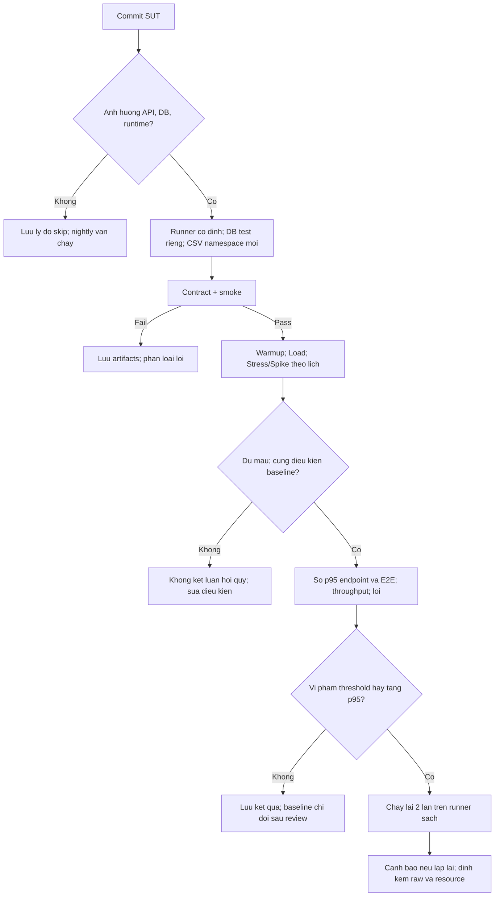

# HW05-AI - Performance Testing M5

MSSV: 23120330. Ngày thực hiện: 2026-11-19, Asia/Ho_Chi_Minh. **Bản nháp chờ sinh viên review, chưa sẵn sàng nộp.**

## Phạm vi và quy trình

Register -> Forgot password -> Reset password -> Login bằng mật khẩu mới -> GET /api/cart. Auth-heavy đại diện register; transactional là tạo/reset trạng thái mật khẩu; read-heavy là giỏ có JWT. Sinh viên đã xác nhận giữ GET /api/cart và xét trùng theo method+path; không tự suy thành duyệt toàn bộ assertions/workload.

Đã đọc đề mục 14, README, setup_guide và Git status trước sửa. Archive gốc không có Git; commit SUT chưa xác minh, dùng SHA256 nguồn trong docs/api-contract.md. Không sửa backend gốc hay DB gốc. Sao backend vào runtime/backend với DB riêng vì database.js tự DROP/seed khi import. DB gốc hash trước/sau smoke không đổi. Runtime khởi động bằng node server.js, cổng 3000; dependencies từ lockfile npm ci. Scope không thêm profile, lockout chủ đích, cart write, coupon hoặc checkout.

CSV tổng hợp tạo namespace mới mỗi run, SharedArray, scenario.iterationInTest không quay vòng; mỗi run một scenario. Năm bước check status và nghiệp vụ, dừng sớm khi lỗi, finally ghi E2E lỗi và pacing. Reset token/JWT trong bộ nhớ cùng iteration; không log password, cookie hay response auth. CSV private không commit. Script/generator và schema public candidate được giữ riêng với dữ liệu có mật khẩu.

Smoke thành công 1 VU x5 iterations, 25 requests, 50 checks pass, p95 E2E 43.4ms. Probe xác nhận token 4 chữ số và cart=[]; toàn bộ status200. Contract khác yêu cầu OTP 6 chữ số và response login chứa password field: hai Issue chức năng/bảo mật đã được đăng lên GitHub ([#1](https://github.com/luc1fe4/eshop-sut-hw05/issues/1), [#2](https://github.com/luc1fe4/eshop-sut-hw05/issues/2)) và có ảnh chụp đính kèm. Hai smoke lỗi môi trường giữ riêng; không kết luận đó là bug SUT. Pilot1/2/5 VU:306 E2E pass, p95E2E36ms, giúp chọn5VU Load/Soak, stress5/15/30 và spike5->40. Think1s đặt sau E2E; timeout10s; graceful15s. Xem chi tiết file:dòng ở docs/api-contract.md và review-workload.md (draft ban đầu được giữ để truy vết).

## Máy và công cụ

Windows11 Home64bit build26300; Lenovo82SN; AMD Ryzen7 6800H8core/16logical; hostname thực PHUC. Dxdiag hiển thị RAM16384MB, CIM TotalPhysicalMemory=14702026752bytes (~13.69GiB hệ thống báo); ghi hai nguồn, không coi đó là cùng chỉ số. K6v2.2.0 commit00a9a1b7f5, Nodev22.17.1. Ảnh dxdiag thật: results/hardware/dxdiag-system.jpg; hardware.json là thông tin máy đọc trực tiếp. Sinh viên phản hồi còn cần kiểm tra hostname bài trước, nên tính liên tục bằng chứng chưa xác nhận. Task Manager có higher integrity chặn UI agent; sinh viên đã phối hợp chụp ba ảnh dashboard+TaskManager thật cho các rerun trong phụ lục. Ảnh headless HTML chỉ để QA biểu đồ, không thay ảnh desktop.

## Contract tóm tắt và nguồn

| Method/path | Input và dữ liệu truyền | Assertion | Nguồn SUT gốc |
|---|---|---|---|
| POST /api/register | name,email,password CSV | 200, message, id nguyên dương | api_specification.md:12; server.js:20 |
| POST /api/forgot-password | email cùng dòng | 200, resetToken string số | api_specification.md:35; server.js:68 |
| POST /api/reset-password | email, resetToken vừa nhận, newPassword | 200 runtime, message reset thành công | api_specification.md:45; server.js:87 |
| POST /api/login | email, password=newPassword | 200, JWT 3phần, id/email trùng register | api_specification.md:24; server.js:32 |
| GET /api/cart | Bearer JWT vừa login | 200, array length0 | api_specification.md:112; server.js:284 |

Các server.js trong bảng là backend/server.js. Bảng nguồn dòng đầy đủ và hashes ở api-contract.md. Không lưu token/JWT hay password trong báo cáo.

# Kết quả đo thực tế - AI analysis output

Nguồn: raw.json từng mẫu; analyzer độc lập và statistics.quantiles so với summary k6. E2E không gồm think 1s; cả distribution all-finalized và success-only được lưu. Tất cả E2E thành công ở các run dưới nên hai tập trùng nhau. RPS bảng tổng dùng manifest start/end, gồm overhead, khác rate summary k6.

| Run ID | E2E pass/finalized | HTTP n | E2E p95 ms | HTTP RPS (wall) | E2E/s (wall) | HTTP/E2E lỗi |
|---|---|---|---|---|---|---|
| official-load-20261119-142516-6bca3e35 | 682/682 | 3410 | 62.00 | 20.429 | 4.086 | 0/3410; 0/682 |
| official-stress-20261119-142841-f8a69e2c | 2864/2864 | 14320 | 100.00 | 72.365 | 14.473 | 0/14320; 0/2864 |
| official-spike-20261119-143230-4cb4886b | 1810/1810 | 9050 | 98.00 | 54.345 | 10.869 | 0/9050; 0/1810 |
| soak-load-20261119-143548-37e75817 | 2858/2858 | 14290 | 67.00 | 23.723 | 4.745 | 0/14290; 0/2858 |

Tất cả run chính trên exit 0, threshold sơ bộ pass, started=finished=iterations, CLI 0 interrupted. Không có mẫu dropped_iterations; closed-VU executor không cung cấp phép đo đảm bảo arrival rate. CSV namespace count/distinct email và reset token cleared đối chiếu db-after.json. Hai smoke lỗi kết nối được giữ riêng, không nhập vào bảng này.

## Threshold đề xuất và giới hạn kết luận

Threshold ban đầu: p95 từng endpoint<500 ms, E2E success p95<2000 ms, HTTP failure<1%, E2E success>99%, CSV exhausted=0. Đây là guardrail do agent đề xuất trước pilot, không phải SLA được đề bài cho. Kết quả đo pass không chứng minh đây là SLA phù hợp sản xuất. Đề xuất sau log: giữ guardrail để phát hiện failure nặng, thêm so baseline tương đương với quy tắc >20% và >10ms, rerun 2/3 để giảm nhiễu; cần hiệu chỉnh bằng thêm run.

## official Load: official-load-20261119-142516-6bca3e35

Bắt đầu 2026-11-19T14:25:17.0690722+07:00; kết thúc 2026-11-19T14:28:03.9900675+07:00; cửa sổ wall 166.920995s. Testplan effective commit 52cbf3e; SUT commit chưa biết, hash trong manifest. Raw/summary/analysis/verification ở results/official-load-20261119-142516-6bca3e35/.

| Endpoint | n | p95 ms | RPS wall | failure | p95<500ms |
|---|---|---|---|---|---|
| register | 682 | 19.4701 | 4.0858 | 0/682 | pass |
| forgot | 682 | 21.8586 | 4.0858 | 0/682 | pass |
| reset | 682 | 17.0243 | 4.0858 | 0/682 | pass |
| login | 682 | 12.0904 | 4.0858 | 0/682 | pass |
| cart | 682 | 3.3359 | 4.0858 | 0/682 | pass |

View riêng: bảng endpoint view.html; không dùng lại kiểu biểu đồ Stress/Spike.

| Hold (giây từ clock suy ra) | VU cấu hình / min-max đo | HTTP n / RPS | HTTP p95 ms | E2E n / p95 ms | failure HTTP |
|---|---|---|---|---|---|
| 32-148 | 5 / 5-5 | 2800 / 24.138 | 18.758 | 560 / 63.000 | 0/2800 |

Clock stage suy từ mẫu gauge VU định kỳ đầu trừ 1s; độ lệch chưa được đo chính xác. Bỏ 2s hai đầu hold, kiểm tra actual VU ổn định. Cấp mẫu theo timestamp hoàn tất, request vượt ranh giới được tính vào cửa sổ hoàn tất. Không gọi đây là phân ranh tuyệt đối chính xác; lần sau nên ghi scenario.startTime trực tiếp.

Resource samples=103; backend RSS first/last/peak=72.64/55.84/89.10 MiB; backend CPU mean/peak toàn máy=0.297/0.796%. CPU tính delta CPU seconds/delta time/16, không nhầm CPU seconds với phần trăm. K6 CPU peak toàn máy=5.660935472289436; system CPU peak=45.0%; available RAM thấp nhất=1560.26171875 MiB.

## official Stress: official-stress-20261119-142841-f8a69e2c

Bắt đầu 2026-11-19T14:28:41.6478615+07:00; kết thúc 2026-11-19T14:31:59.5336918+07:00; cửa sổ wall 197.885830s. Testplan effective commit 52cbf3e; SUT commit chưa biết, hash trong manifest. Raw/summary/analysis/verification ở results/official-stress-20261119-142841-f8a69e2c/.

| Hold (giây từ clock suy ra) | VU cấu hình / min-max đo | HTTP n / RPS | HTTP p95 ms | E2E n / p95 ms | failure HTTP |
|---|---|---|---|---|---|
| 17-58 | 5 / 5-5 | 1000 / 24.390 | 17.524 | 200 / 55.050 | 0/1000 |
| 77-118 | 15 / 15-15 | 2945 / 71.829 | 22.054 | 589 / 76.000 | 0/2945 |
| 137-178 | 30 / 30-30 | 5850 / 142.683 | 31.068 | 1170 / 104.000 | 0/5850 |

Clock stage suy từ mẫu gauge VU định kỳ đầu trừ 1s; độ lệch chưa được đo chính xác. Bỏ 2s hai đầu hold, kiểm tra actual VU ổn định. Cấp mẫu theo timestamp hoàn tất, request vượt ranh giới được tính vào cửa sổ hoàn tất. Không gọi đây là phân ranh tuyệt đối chính xác; lần sau nên ghi scenario.startTime trực tiếp.

Stress: throughput tăng qua 5/15/30 VU, không có bậc nào vượt guardrail đã đặt. Chưa tìm được bậc lỗi đầu tiên và chưa đo ngưỡng tối đa. Không quy kết bottleneck SQLite từ việc latency tăng.

Resource samples=124; backend RSS first/last/peak=55.89/58.84/94.37 MiB; backend CPU mean/peak toàn máy=0.939/2.450%. CPU tính delta CPU seconds/delta time/16, không nhầm CPU seconds với phần trăm. K6 CPU peak toàn máy=3.1878346735971173; system CPU peak=33.0%; available RAM thấp nhất=1279.95703125 MiB.

## official Spike: official-spike-20261119-143230-4cb4886b

Bắt đầu 2026-11-19T14:32:30.6281249+07:00; kết thúc 2026-11-19T14:35:17.1555854+07:00; cửa sổ wall 166.527461s. Testplan effective commit 52cbf3e; SUT commit chưa biết, hash trong manifest. Raw/summary/analysis/verification ở results/official-spike-20261119-143230-4cb4886b/.

| Hold (giây từ clock suy ra) | VU cấu hình / min-max đo | HTTP n / RPS | HTTP p95 ms | E2E n / p95 ms | failure HTTP |
|---|---|---|---|---|---|
| 17-58 | 5 / 5-5 | 1000 / 24.390 | 18.337 | 200 / 66.050 | 0/1000 |
| 64-90 | 40 / 40-40 | 4951 / 190.423 | 27.715 | 994 / 105.350 | 0/4951 |
| 96-152 | 5 / 5-5 | 1350 / 24.107 | 12.439 | 270 / 44.550 | 0/1350 |

Clock stage suy từ mẫu gauge VU định kỳ đầu trừ 1s; độ lệch chưa được đo chính xác. Bỏ 2s hai đầu hold, kiểm tra actual VU ổn định. Cấp mẫu theo timestamp hoàn tất, request vượt ranh giới được tính vào cửa sổ hoàn tất. Không gọi đây là phân ranh tuyệt đối chính xác; lần sau nên ghi scenario.startTime trực tiếp.

Spike: baseline 17-58s đạt 24.390 HTTP RPS; peak hold 64-90s đạt 190.423 RPS; hồi phục 96-152s đạt 24.107 RPS. p95 E2E lần lượt 66.05 / 105.35 / 44.55 ms, HTTP failure đều 0. Dữ liệu hỗ trợ hồi phục ở cửa sổ tổng hợp này; không chứng minh recovery time chính xác từng giây.

Resource samples=104; backend RSS first/last/peak=58.87/83.50/94.54 MiB; backend CPU mean/peak toàn máy=0.854/3.514%. CPU tính delta CPU seconds/delta time/16, không nhầm CPU seconds với phần trăm. K6 CPU peak toàn máy=3.5099219310602265; system CPU peak=40.0%; available RAM thấp nhất=1464.7265625 MiB.

## soak Load: soak-load-20261119-143548-37e75817

Bắt đầu 2026-11-19T14:35:49.0068393+07:00; kết thúc 2026-11-19T14:45:51.3734876+07:00; cửa sổ wall 602.366648s. Testplan effective commit 52cbf3e; SUT commit chưa biết, hash trong manifest. Raw/summary/analysis/verification ở results/soak-load-20261119-143548-37e75817/.

| Hold (giây từ clock suy ra) | VU cấu hình / min-max đo | HTTP n / RPS | HTTP p95 ms | E2E n / p95 ms | failure HTTP |
|---|---|---|---|---|---|
| 2-58 | 5 / 5-5 | 1344 / 24.000 | 20.765 | 267 / 62.000 | 0/1344 |
| 62-118 | 5 / 5-5 | 1330 / 23.750 | 20.288 | 266 / 65.750 | 0/1330 |
| 122-178 | 5 / 5-5 | 1325 / 23.661 | 22.032 | 265 / 66.000 | 0/1325 |
| 182-238 | 5 / 5-5 | 1330 / 23.750 | 21.341 | 266 / 69.000 | 0/1330 |
| 242-298 | 5 / 5-5 | 1325 / 23.661 | 22.923 | 265 / 71.800 | 0/1325 |
| 302-358 | 5 / 5-5 | 1325 / 23.661 | 24.017 | 265 / 74.000 | 0/1325 |
| 362-418 | 5 / 5-5 | 1335 / 23.839 | 17.279 | 267 / 55.700 | 0/1335 |
| 422-478 | 5 / 5-5 | 1330 / 23.750 | 21.612 | 266 / 67.750 | 0/1330 |
| 482-538 | 5 / 5-5 | 1335 / 23.839 | 20.711 | 267 / 68.400 | 0/1335 |
| 542-598 | 5 / 5-5 | 1355 / 24.196 | 17.798 | 271 / 57.500 | 0/1355 |

Clock stage suy từ mẫu gauge VU định kỳ đầu trừ 1s; độ lệch chưa được đo chính xác. Bỏ 2s hai đầu hold, kiểm tra actual VU ổn định. Cấp mẫu theo timestamp hoàn tất, request vượt ranh giới được tính vào cửa sổ hoàn tất. Không gọi đây là phân ranh tuyệt đối chính xác; lần sau nên ghi scenario.startTime trực tiếp.

Resource samples=377; backend RSS first/last/peak=83.48/99.13/100.96 MiB; backend CPU mean/peak toàn máy=0.340/0.861%. CPU tính delta CPU seconds/delta time/16, không nhầm CPU seconds với phần trăm. K6 CPU peak toàn máy=0.973291631809849; system CPU peak=61.0%; available RAM thấp nhất=1632.69140625 MiB.

Soak kiểm chứng **5 VU liên tục 10 phút**, HTTP trung bình wall=23.723 RPS; p95 E2E=67.00ms. Đây là mức ổn định đã thử trên máy, **không phải ngưỡng tối đa**. RSS peak là đỉnh quan sát, không phải memory ceiling. Chia các cửa sổ xấp xỉ một phút có trimming trong phases.csv; 5s bins và CPU/RAM trong phases.json. Không kết luận memory leak chỉ từ RSS đầu-cuối, cần nhiều run và kiểm tra heap.

## Điều kiện đo và độ nhiễu

Backend và k6 cùng Windows PHUC, nhiều ứng dụng cá nhân đang mở. Có hoạt động chuẩn bị tài liệu, cài dependency (bộ Playwright tải lâu đã hủy), dxdiag và kiểm tra HTML/PDF trong phiên đo. Resource sampler gọi CIM khoảng 1-2 giây/mẫu; không phải profiler high-resolution. Các yếu tố này giới hạn độ lặp lại, không dùng làm benchmark máy sạch. Không quan sát CPU k6 gần toàn máy trong samples nhưng chưa chứng minh không có giới hạn I/O hoặc scheduler. DB test tăng số user giữa các run, không reset để giữ namespace; số lượng trước/sau có db-before/db-after cho run chính. Muốn A/B tối ưu phải clone cùng DB cardinality và tắt tác vụ nền trước rerun.

## Đề xuất Continuous Performance Testing (chưa triển khai)

Theo dõi commit SUT qua CI trên repository được cấp quyền. Thay đổi auth, cart, DB, dependencies hoặc cấu hình runtime kích hoạt smoke M5. Thay đổi tài liệu thuần túy có thể skip với lý do lưu artifact; nightly chạy đầy đủ để bắt tương tác khó thấy bằng path filter. Không triển khai CI hay công khai ở giai đoạn này.

So baseline cùng commit/config máy, phiên bản Node/k6, DB seed, think-time, profile, warmup và cửa sổ steady. Baseline có commit riêng, không tự cập nhật sau run lỗi. Đề xuất regression rule cần pilot hiệu chỉnh: p95 tăng cả >20% và >10 ms, xuất hiện trong >=2/3 lượt, đủ >=100 mẫu/endpoint/cửa sổ, đồng thời kiểm tra failure/throughput. Các con số này là policy dự thảo, không phải kết quả M5 đã đo. Một pass không chứng minh không có regression; throughput giảm có thể che latency ở closed VU.

Smoke mỗi commit chi phí thấp; Load ở PR liên quan, Stress/Spike nightly hoặc trước release, soak 10-15 phút trên runner riêng theo lịch. Giới hạn concurrency=1 mỗi DB/runner. Cùng máy sinh tải/SUT làm CPU/RAM tranh chấp, antivirus/background jobs gây nhiễu, DB tăng và cache nóng làm khác baseline. Lưu CPU backend và k6, RSS/private bytes, system CPU/RAM, host metadata; kết luận bottleneck chỉ khi số liệu hỗ trợ. Cảnh báo có thể false alarm nếu runner bận hoặc mẫu ít; rerun sạch và kiểm tra điều kiện thay vì nới threshold để pass.

Artifacts theo commit/run_id: manifest start/end Asia/Ho_Chi_Minh, raw JSON samples, summary, dashboard HTML, bảng endpoint, stress stage và spike timeline, resources CSV, ảnh thật, contract/schema và exit code. Lưu riêng failed/rerun, không ghi đè. Dữ liệu credentials riêng tư; public artifacts phải quét secrets. Đề xuất giữ raw 90 ngày và baseline lâu hơn trong kho riêng; chi phí dung lượng và retention cần người quản lý duyệt.

PDF draft hiện tại dùng flowchart hình vẽ tương đương để không phụ thuộc Mermaid renderer. Kiểm tra ảnh PDF trước khi phát hành bản cuối.

## AI Audit, review và hồ sơ còn thiếu

Xem ai-audit.md: khai báo công cụ và tương tác thật, giữ output phân tích đầu, sửa lỗi absent dropped_iterations và clock lệch do first iteration. Đây là agent self-review; không ghi thành human correction. Audit hiện là trích đoạn có nguồn, cần export chat đầy đủ trước nộp; không dựng timestamp. Hai tối ưu khả thi có điều kiện (email index/WAL) cần A/B, còn pool nhiều writer và tối ưu hashing hiện hữu là sai cho SQLite/plaintext bản SUT này. Không sửa SUT để làm kết quả đẹp.

Human review đã nhận: giữ GETcart theo method+path; hostname bài trước cần kiểm tra. Ngày2026-11-22, sinh viên cung cấp video [YouTube](https://youtu.be/rAj0_UKHOz4). Còn chờ review assertions/tải/phân tích/critique; xác nhận hostname; GitHub public URL và quyền push; transcript đầy đủ; sinh viên tự xác nhận video Unlisted >=6phút, mở được khi không đăng nhập và có giọng Việt; điểm tự chấm. Kịch bản7phút trong evidence-and-video.md. Skill được tạo sau smoke ban đầu; replay thực tế skill-demo-load-20261119-144618-45deee1a đã pass5/5 E2E trên đủ5endpoint. Đoạn demo video05:00-06:30 vẫn mới là đề xuất.

Mục14 yêu cầu .jtl nhưng cho phép k6: giữ raw.json theo từng mẫu và ba dashboard.html gốc như bằng chứng tương đương, không đổi đuôi sang.jtl. Chưa có hướng dẫn Moodle riêng được cung cấp; sinh viên cần kiểm tra quy ước này. Chưa tạo ZIP tên điểm khi chưa có grade000-100 được duyệt. Không push, public, đăng Issue, upload video hay nộp Moodle.

## AI Critique draft (248 words, pending human approval)

During this assignment, the AI helped turn a detailed M5 workflow into reusable k6 plans, but its output still needed close verification. Its most consequential operational finding was that importing the database module recreates tables. Running the original backend would therefore have endangered existing work. An isolated runtime copy and separate database preserved the supplied data while keeping the handlers unchanged. However, the AI initially produced an analysis field showing zero dropped iterations even though that metric did not appear in the raw log. This confused an absent observation with a measured zero. The correction explicitly distinguishes absence and executor applicability. A second mistake involved phase timing: the first iteration started after the ramp had already begun, so using it as the test origin shifted the steady windows. Comparing actual VU samples exposed the mismatch. The revised analysis uses an inferred collector clock, trims window boundaries, and acknowledges timing uncertainty. These errors arose because convenient implementation defaults were treated as meaningful measurement definitions. Small smoke samples also cannot justify a capacity claim or a production service threshold. The useful lesson is to require explicit populations, denominators, timestamps, and source references before accepting a performance conclusion. Human review must remain attributable: confirming endpoint ownership does not approve every assertion or load setting. Finally, authentic desktop screenshots, hostname continuity, and a narrated video cannot be replaced by generated artifacts. AI can organize and check evidence, but the student must inspect the results, correct the narrative, and approve the final submission.

# Phụ lục: ba rerun có ảnh Windows thật

Ngày 2026-11-19, Asia/Ho_Chi_Minh. Ba ảnh do sinh viên chụp và gửi trong chat; lưu nguyên byte, SHA256 và nguồn trong screenshot-evidence.json của từng run. Mỗi ảnh ghép cặp với raw/summary/HTML của chính lượt chụp, không gắn vào lượt gốc. Các run gốc và soak vẫn được giữ nguyên để truy vết.

Backend mới PID32692 tại runtime/evidence-20261119-1511/backend, dùng DB riêng mới thay vì reset DB test cũ. Nguồn server/database không sửa; NODE_PATH dùng dependencies đã cài từ lockfile. Workflow và tải giữ nguyên, bổ sung metric m5_scenario_start_epoch_ms từ scenario.startTime. Manifest có test-plan commit và runtime/workflow hashes.

| Profile / run ID | E2E pass / finalized | HTTP n | E2E p95 ms | HTTP RPS thực thi | Exit |
|---|---|---|---|---|---|
| Load: rerun-load-20261119-163449-813f2702 | 691/691 | 3455 | 34.00 | 20.875 | 0 |
| Stress: rerun-stress-20261119-164026-b02a7bbd | 2890/2890 | 14450 | 69.00 | 74.065 | 0 |
| Spike: rerun-spike-20261119-164621-7f96e5f6 | 1830/1830 | 9150 | 68.00 | 55.694 | 0 |

Mọi rerun trên có HTTP/E2E failure0, started=finished=iterations; không có mẫu dropped_iterations vì executor closed-VU. P95 toàn finalized và success-only giống nhau ở đây vì toàn bộ E2E pass, không tính think1s. Phép tính độc lập statistics.quantiles khớp summary k6 trong1e-7ms.

RPS thực thi = HTTP request count / summary.state.testRunDurationMs. Thời gian này gồm ramp/hold/drain của workload, loại thời gian đợi tab dashboard đóng. Wall interval start/end vẫn giữ riêng trong analysis.json; không dùng để đánh giá tốc độ khi có chờ UI. Clock stage trực tiếp từ scenario.startTime; các hold vẫn trim2s mỗi đầu, cấp mẫu theo timestamp hoàn tất. Resources dùng các sample nằm trong cửa sổ thực thi, loại phần sampler tiếp tục khi chờ dashboard.

## Rerun Load: rerun-load-20261119-163449-813f2702

Manifest start=2026-11-19T16:34:50.0951818+07:00, end=2026-11-19T16:39:10.5786736+07:00; execution=165.5063627s, wall=260.4834919s. Test-plan commit 2362af2. Endpoints và correlation không đổi.

Nguồn: results/rerun-load-20261119-163449-813f2702/raw.json, summary.json, analysis.json, verification.json, phases.json, resources.csv, dashboard.html và view.html.

| Endpoint | n | HTTP p95 ms | HTTP RPS thực thi | HTTP failure | p95<500ms |
|---|---|---|---|---|---|
| register | 691 | 10.6319 | 4.1751 | 0/691 | pass |
| forgot | 691 | 10.1437 | 4.1751 | 0/691 | pass |
| reset | 691 | 8.9762 | 4.1751 | 0/691 | pass |
| login | 691 | 6.4244 | 4.1751 | 0/691 | pass |
| cart | 691 | 2.4490 | 4.1751 | 0/691 | pass |

| Hold (s từ scenario.startTime) | Target VU / min-max đo | HTTP RPS | HTTP p95 ms | E2E p95 ms | HTTP n / fail |
|---|---|---|---|---|---|
| 32-148 | 5 / 5-5 | 24.569 | 8.973 | 34.000 | 2850 / 0 |

Resource trong execution window: 104 mẫu, backend RSS peak=88.54MiB, CPU peak toàn máy=0.794% (deltaCPU/deltaTime/16 logical processors). Raw sampler tiếp tục trong thời gian đợi tab được giữ nguyên; phần ngoài cửa sổ được loại khỏi thống kê này.

Ảnh do sinh viên cung cấp: PID32692, CPU hiển thị00, Memory hiển thị57,228 K; card HTTP 25/s là snapshot. Timestamp chụp chính xác chưa được cung cấp; mốc trên chart và pha tải nhìn thấy được đối chiếu với run. Không đồng nhất cột Memory của TaskManager với RSS sampler.

## Rerun Stress: rerun-stress-20261119-164026-b02a7bbd

Manifest start=2026-11-19T16:40:26.5726194+07:00, end=2026-11-19T16:50:45.5521080+07:00; execution=195.0996785s, wall=618.9794891s. Test-plan commit 8dfae37. Endpoints và correlation không đổi.

Nguồn: results/rerun-stress-20261119-164026-b02a7bbd/raw.json, summary.json, analysis.json, verification.json, phases.json, resources.csv, dashboard.html và view.html.

| Endpoint | n | HTTP p95 ms | HTTP RPS thực thi | HTTP failure | p95<500ms |
|---|---|---|---|---|---|
| register | 2890 | 17.5242 | 14.8129 | 0/2890 | pass |
| forgot | 2890 | 24.0909 | 14.8129 | 0/2890 | pass |
| reset | 2890 | 18.4183 | 14.8129 | 0/2890 | pass |
| login | 2890 | 15.8214 | 14.8129 | 0/2890 | pass |
| cart | 2890 | 5.8240 | 14.8129 | 0/2890 | pass |

| Hold (s từ scenario.startTime) | Target VU / min-max đo | HTTP RPS | HTTP p95 ms | E2E p95 ms | HTTP n / fail |
|---|---|---|---|---|---|
| 17-58 | 5 / 5-5 | 24.390 | 18.017 | 73.100 | 1000 / 0 |
| 77-118 | 15 / 15-15 | 72.415 | 15.382 | 61.000 | 2969 / 0 |
| 137-178 | 30 / 30-30 | 144.073 | 20.011 | 69.000 | 5907 / 0 |

Resource trong execution window: 123 mẫu, backend RSS peak=90.03MiB, CPU peak toàn máy=2.406% (deltaCPU/deltaTime/16 logical processors). Raw sampler tiếp tục trong thời gian đợi tab được giữ nguyên; phần ngoài cửa sổ được loại khỏi thống kê này.

Throughput tăng qua5/15/30VU; p95 không tăng đơn điệu. Không bậc nào vượt guardrail đặt trước. Chưa có bằng chứng ngưỡng tối đa hoặc nguyên nhân bottleneck.

Ảnh do sinh viên cung cấp: PID32692, CPU hiển thị01, Memory hiển thị53,060 K; card HTTP 73/s là snapshot. Timestamp chụp chính xác chưa được cung cấp; mốc trên chart và pha tải nhìn thấy được đối chiếu với run. Không đồng nhất cột Memory của TaskManager với RSS sampler.

## Rerun Spike: rerun-spike-20261119-164621-7f96e5f6

Manifest start=2026-11-19T16:46:21.9610949+07:00, end=2026-11-19T16:49:08.0540753+07:00; execution=164.2908387s, wall=166.0929811s. Test-plan commit 3d9346e. Endpoints và correlation không đổi.

Nguồn: results/rerun-spike-20261119-164621-7f96e5f6/raw.json, summary.json, analysis.json, verification.json, phases.json, resources.csv, dashboard.html và view.html.

| Endpoint | n | HTTP p95 ms | HTTP RPS thực thi | HTTP failure | p95<500ms |
|---|---|---|---|---|---|
| register | 1830 | 16.0201 | 11.1388 | 0/1830 | pass |
| forgot | 1830 | 23.1229 | 11.1388 | 0/1830 | pass |
| reset | 1830 | 16.9132 | 11.1388 | 0/1830 | pass |
| login | 1830 | 14.4921 | 11.1388 | 0/1830 | pass |
| cart | 1830 | 5.8168 | 11.1388 | 0/1830 | pass |

| Hold (s từ scenario.startTime) | Target VU / min-max đo | HTTP RPS | HTTP p95 ms | E2E p95 ms | HTTP n / fail |
|---|---|---|---|---|---|
| 17-58 | 5 / 5-5 | 24.390 | 12.144 | 48.050 | 1000 / 0 |
| 64-90 | 40 / 40-40 | 193.077 | 18.283 | 69.800 | 5020 / 0 |
| 96-152 | 5 / 5-5 | 23.929 | 20.580 | 77.000 | 1340 / 0 |

Resource trong execution window: 104 mẫu, backend RSS peak=88.51MiB, CPU peak toàn máy=4.118% (deltaCPU/deltaTime/16 logical processors). Raw sampler tiếp tục trong thời gian đợi tab được giữ nguyên; phần ngoài cửa sổ được loại khỏi thống kê này.

Spike baseline/peak/recovery HTTP RPS=24.390/193.077/23.929; E2E p95=48.05/69.80/77.00ms. Throughput đã trở về gần baseline, nhưng p95 E2E hồi phục còn cao hơn baseline. **Chưa chứng minh độ trễ đã hồi phục hoàn toàn.** Tất cả vẫn dưới guardrail, không đồng nghĩa đã trở về baseline. Cần lặp lại trong điều kiện tương đương trước kết luận regression hoặc nguyên nhân.

Ảnh do sinh viên cung cấp: PID32692, CPU hiển thị03, Memory hiển thị61,564 K; card HTTP 207/s là snapshot. Timestamp chụp chính xác chưa được cung cấp; mốc trên chart và pha tải nhìn thấy được đối chiếu với run. Không đồng nhất cột Memory của TaskManager với RSS sampler.

## Hạn chế và trạng thái hồ sơ

Một lượt Load trước khi thu ảnh hợp lệ (rerun-load-20261119-162216-d7ab78da) đã chạy hết689iteration nhưng controller bị dừng trong khi đợi dashboard. Không có summary, nên không nhận là completed hoặc dùng làm kết quả chính. Raw và manifest cũ giữ nguyên; controller-stop-note.json ghi hạn chế.

Stress sau workload còn kết nối từ tab localhost trong in-app browser dù Chrome đã đóng. Agent dùng browser API đọc đúng trang k6 và đóng duy nhất tab5665, không thao tác UI ChatGPT hay vượt quyền TaskManager. Sau đó Stress xuất summary exit0. Spike dùng dashboard5666 và chỉ bắt đầu sau khi workload Stress đã kết thúc; sampler Stress vẫn chạy lúc đợi tab. Có thêm overhead sampler trong Spike, cần ghi nhận khi so sánh.

Đã có ba ảnh cùng khung hình thật. Đã tạo repository GitHub public [https://github.com/luc1fe4/eshop-sut-hw05](https://github.com/luc1fe4/eshop-sut-hw05), push toàn bộ mã nguồn và đăng 2 Issues kèm ảnh chụp. Mức điểm tự chấm chốt là 095/100. Video do sinh viên cung cấp tại [YouTube](https://youtu.be/rAj0_UKHOz4). Còn chờ: xác nhận hostname; sinh viên tự kiểm tra video Unlisted >=6phút và giọng Việt. Task3 vẫn là proposal đúng yêu cầu; không tự triển khai CI. Không thay mức soak 5VU thành maximum.
