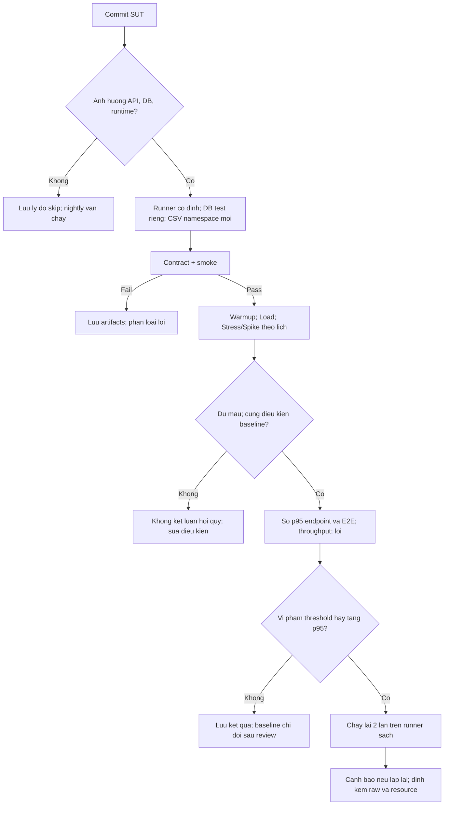

# Continuous Performance Testing - proposal only

Theo dõi commit SUT qua CI trên repository được cấp quyền. Thay đổi auth, cart, DB, dependencies hoặc cấu hình runtime kích hoạt smoke M5. Thay đổi tài liệu thuần túy có thể skip với lý do lưu artifact; nightly chạy đầy đủ để bắt tương tác khó thấy bằng path filter. Không triển khai CI hay công khai ở giai đoạn này.

So baseline cùng commit/config máy, phiên bản Node/k6, DB seed, think-time, profile, warmup và cửa sổ steady. Baseline có commit riêng, không tự cập nhật sau run lỗi. Đề xuất regression rule cần pilot hiệu chỉnh: p95 tăng cả >20% và >10 ms, xuất hiện trong >=2/3 lượt, đủ >=100 mẫu/endpoint/cửa sổ, đồng thời kiểm tra failure/throughput. Các con số này là policy dự thảo, không phải kết quả M5 đã đo. Một pass không chứng minh không có regression; throughput giảm có thể che latency ở closed VU.

Smoke mỗi commit chi phí thấp; Load ở PR liên quan, Stress/Spike nightly hoặc trước release, soak 10-15 phút trên runner riêng theo lịch. Giới hạn concurrency=1 mỗi DB/runner. Cùng máy sinh tải/SUT làm CPU/RAM tranh chấp, antivirus/background jobs gây nhiễu, DB tăng và cache nóng làm khác baseline. Lưu CPU backend và k6, RSS/private bytes, system CPU/RAM, host metadata; kết luận bottleneck chỉ khi số liệu hỗ trợ. Cảnh báo có thể false alarm nếu runner bận hoặc mẫu ít; rerun sạch và kiểm tra điều kiện thay vì nới threshold để pass.

Artifacts theo commit/run_id: manifest start/end Asia/Ho_Chi_Minh, raw JSON samples, summary, dashboard HTML, bảng endpoint, stress stage và spike timeline, resources CSV, ảnh thật, contract/schema và exit code. Lưu riêng failed/rerun, không ghi đè. Dữ liệu credentials riêng tư; public artifacts phải quét secrets. Đề xuất giữ raw 90 ngày và baseline lâu hơn trong kho riêng; chi phí dung lượng và retention cần người quản lý duyệt.

PDF draft hiện tại dùng flowchart hình vẽ tương đương để không phụ thuộc Mermaid renderer. Kiểm tra ảnh PDF trước khi phát hành bản cuối.
